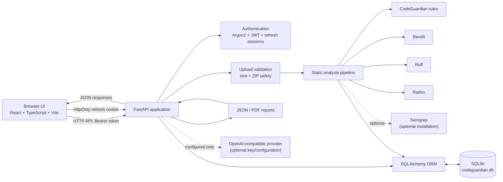
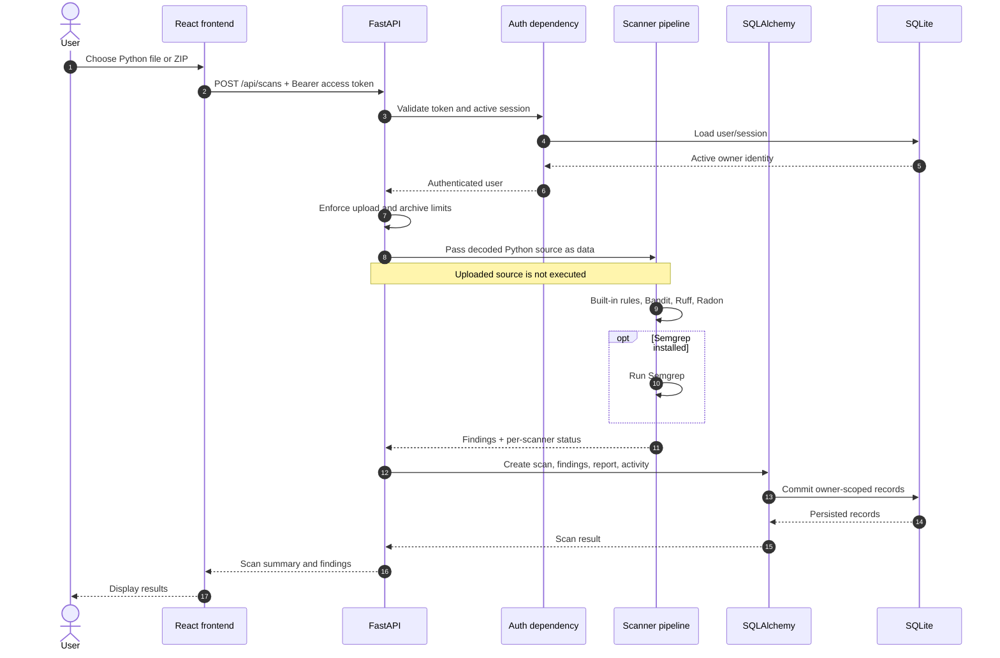
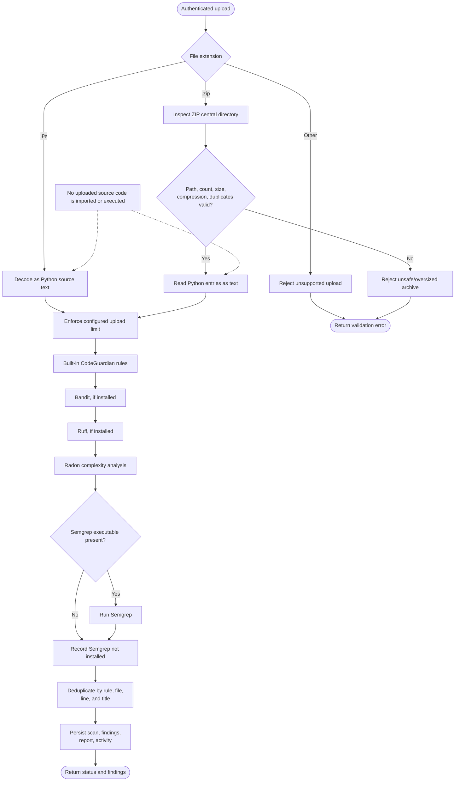
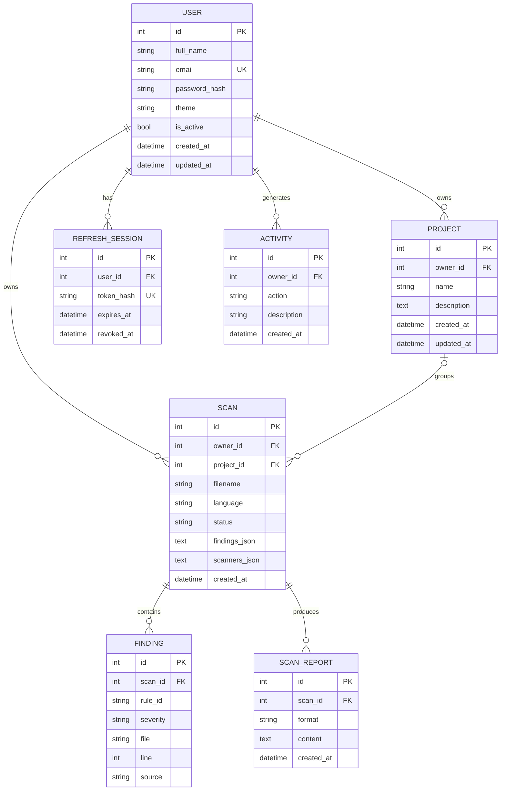

# CodeGuardian AI — Architecture

This document describes the implemented application at a component and request-flow level. SQLite is the default local database. Semgrep and AI-provider connectivity are optional.

## 1. System architecture



### Component responsibilities

- **Browser UI:** login/registration, navigation, dashboard, projects, scan submission, findings, reports, settings, and profile.
- **FastAPI:** request validation, CORS, authentication, ownership checks, scanning orchestration, dashboard aggregation, and report endpoints.
- **Authentication:** Argon2 password hashes, signed access JWTs, refresh-session records, rotation, and revocation.
- **Scanner:** deterministic checks and integrations with installed analysis tools. Scanner statuses distinguish completed, unavailable, and failed tools.
- **SQLite/SQLAlchemy:** application records and relational ownership; Alembic tracks schema revisions.
- **Optional AI:** finding explanations only when provider configuration is present; this is not required for normal scanning.

## 2. Data flow



## 3. Code scanning workflow



The upload path applies the configured maximum byte size. ZIP validation also checks file count, path traversal/absolute paths, expanded size, unusually high compression ratio, duplicate Python paths, and encrypted Python entries. Scanner tools receive temporary source files as data. A tool that is unavailable or fails is represented in scanner status rather than silently treated as successful.

## 4. Authentication workflow

```mermaid
sequenceDiagram
    autonumber
    actor User
    participant UI as React frontend
    participant API as FastAPI
    participant Hash as Argon2 / JWT / token hash
    participant DB as SQLite

    User->>UI: Submit registration or login
    UI->>API: POST /api/auth/register or /api/auth/login
    API->>DB: Find/create user
    API->>Hash: Hash password or verify stored hash
    Hash-->>API: Password verification result
    API->>DB: Create RefreshSession with token hash
    API->>Hash: Sign short-lived access JWT
    API-->>UI: Access token + user + HttpOnly refresh cookie
    Note over UI: Access token held in memory;<br/>not persisted as plaintext

    UI->>API: Protected request + Authorization: Bearer token
    API->>Hash: Verify signature, expiry, and token type
    API->>DB: Verify active user and unrevoked session
    DB-->>API: Active session / user
    API-->>UI: Owner-scoped response

    opt Access token expired while refresh session remains valid
        UI->>API: POST /api/auth/refresh + cookie
        API->>Hash: Hash presented refresh token
        API->>DB: Find, validate, and revoke old session
        API->>DB: Store replacement token hash
        API-->>UI: New access token + replacement HttpOnly cookie
    end

    User->>UI: Log out
    UI->>API: POST /api/auth/logout + cookie
    API->>DB: Revoke refresh session
    API-->>UI: Clear refresh cookie; 204
```

Invalid, expired, or revoked access tokens are rejected by the protected-route dependency. Missing or invalid refresh cookies do not yield a successful session. The frontend coalesces concurrent refresh requests, retries a protected request at most once, and returns a logged-out user to the login route after refresh failure.

## 5. Persistence model



## 6. Deployment and local ports

- Frontend development server: `http://localhost:5174`
- Backend API: `http://127.0.0.1:8000`
- Health endpoint: `/health`
- Interactive API documentation: `/docs`
- Local default database: `backend/codeguardian.db` when running backend commands from `backend`
- Docker Compose database: named `codeguardian_data` volume at `/app/data/codeguardian.db` by default

The Compose backend applies migrations before Uvicorn starts. The Compose frontend uses Vite's development server and is not a production-hardened deployment.
